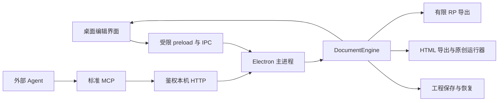

# 原搭架构

原搭把桌面界面、文档模型、交互运行器和 Agent 接口分开。主要原则是：**工程只有一份权威模型，鼠标与 Agent 通过同一套命令修改它。**

## 代码入口

| 位置 | 职责 |
| --- | --- |
| [`app/main.mjs`](../app/main.mjs) | 窗口、文档实例、IPC、保存/恢复、预览、Agent 服务及生命周期 |
| [`app/preload.cjs`](../app/preload.cjs) | 向渲染器暴露有限桌面操作；不开放通用 Node API |
| [`app/core/document.mjs`](../app/core/document.mjs) | 项目校验、命令分派、原子批次、revision 与撤销重做 |
| [`app/core/design-model.mjs`](../app/core/design-model.mjs) | 元件、页面、母版/实例关系与规范化 |
| [`app/core/page-tree-model.mjs`](../app/core/page-tree-model.mjs) | 独立页面目录、混合顺序、父级约束、递归删除与真实页面遍历 |
| [`app/core/guide-model.mjs`](../app/core/guide-model.mjs) | 本地/项目参考线校验，以及普通页面与母版实际使用的参考线集合 |
| [`app/core/hierarchy-model.mjs`](../app/core/hierarchy-model.mjs) | 组、容器归属、重排及锁定约束 |
| [`app/core/interaction-model.mjs`](../app/core/interaction-model.mjs) | 事件、分支、动作、表达式、面板与数据列表契约 |
| [`app/core/view-model.mjs`](../app/core/view-model.mjs)、[`view-commands.mjs`](../app/core/view-commands.mjs) | 自适应继承、覆盖与编辑范围 |
| [`app/core/style-model.mjs`](../app/core/style-model.mjs)、[`style-renderer.mjs`](../app/core/style-renderer.mjs) | 样式校验、继承与可复用呈现 |
| [`app/core/image-model.mjs`](../app/core/image-model.mjs)、[`image-renderer.mjs`](../app/core/image-renderer.mjs) | 保留原图的编辑数据与呈现 |
| [`app/renderer/renderer.js`](../app/renderer/renderer.js) | 当前画布、选区、草稿与编辑命令队列 |
| `app/renderer/*-tools.js`、`editor-shell.js`、`docking.js` | 各编辑区、菜单、工作区设置与面板布局 |
| [`app/core/html-export.mjs`](../app/core/html-export.mjs)、[`html-runtime.mjs`](../app/core/html-runtime.mjs) | 独立 HTML 生成与浏览器交互执行 |
| [`app/core/rp-export.mjs`](../app/core/rp-export.mjs) | 先检查支持范围，再生成 RP 数据；不是 RP 导入器 |
| [`app/agent-schema.mjs`](../app/agent-schema.mjs)、[`agent-server.mjs`](../app/agent-server.mjs)、[`agent-mcp.mjs`](../app/agent-mcp.mjs) | 契约发现、鉴权 HTTP 与标准 MCP 工具 |
| [`app/library-store.mjs`](../app/library-store.mjs)、[`core/library-model.mjs`](../app/core/library-model.mjs) | 本地库登记、校验、独立副本插入与引用重映射 |

## 一次修改如何生效

例如拖动一个元件：界面先显示临时位置，松手后生成移动命令。主进程把命令交给 `DocumentEngine`。引擎在副本上逐条执行，整理母版和连接线等关系，再校验完整工程。任何一步失败都不会把这份副本替换成正式工程；成功且确有变化时才更新状态、增加 revision 并保存一条撤销记录。

Agent 走不同入口，但最终进入相同模型。MCP 先读取 state/schema，再提交 `expectedRevision` 和命令；过期版本被拒绝。预检只运行副本校验，并不锁住项目，所以正式提交仍需再检查版本。

撤销历史目前在内存中保存，最多 80 个已应用快照。文件里的工程版本、运行时 revision、Agent schemaRevision 和应用发行版本是不同概念；不可相互替代。

## 保存与恢复

`.yuanda` 是含模型及内嵌资源的 UTF-8 JSON。打开时规范化缺失的旧字段，再验证引用与类型；非法值不能因为“兼容”而被悄悄接受。保存前先处理未完成输入与待执行命令，写盘失败时保留状态和草稿。

普通工程保存使用临时文件与替换流程，另有备份和延迟恢复记录。Agent 新文件导出使用排他创建，遇到重名分配新名称。文件 I/O 与模型修改是不同副作用，不能把模型撤销理解成恢复任意磁盘状态。

运行数据和恢复记录属于本机实例，不属于公开源码。平台路径由桌面启动层管理；迁移平台应验证真实可写位置、关闭行为和错误恢复，不能只改可执行文件后缀。

## 页面目录与画布

`pages` 只保存真实页面，`pageFolders` 只保存目录；两类对象的 `parentId` 可组成混合树，`pageTreeOrder` 决定同层顺序。目录没有元件、尺寸和交互。选择目录只是编辑器树选中状态，不会替换当前画布或新增标签；文件夹折叠写入工程，普通页面的树折叠是本机工作区偏好。

HTML 使用混合树深度优先遍历得到真实页面列表，第一张真实页面作为首页。折叠只影响编辑器显示，不隐藏导出页面。目录不能作为交互跳页或 Agent 画布选择目标。删除目录递归清理后代与失效引用，删除页面则提升其直接子项；两者均经过同一事务和最后一页保护。当前 RP 写入器拒绝含目录的工程，不把目录转换为空白页。

## 参考线与吸附

项目根对象的 `globalGuides` 保存跨页坐标，页面和母版的 `guides` 保存各自坐标。`canvasGuideSets` 为真实页面返回本页和项目两组，为母版只返回本地一组，避免把编辑器的当前选择当成持久化归属。自适应视图沿用同一页面坐标，不对项目线建立独立覆盖；项目级修改不包进视图命令。

界面通过普通文档命令提交参考线，Agent 通过 schemaRevision 13 发现同一契约。临时拖动带上开始时的项目、编辑目标和 revision；外部修改或目标切换会取消旧手势。显示、锁定、吸附与当前操作范围是工作区偏好，坐标是工程数据。

元件拖入预览使用可见整体边界和现有吸附计算；基础元件、母版、本地库条目的预览和最终命令共享落点。画布移动/未旋转自由缩放也使用本页与项目线。HTML 运行器不绘制编辑辅助线，RP 支持检查明确拒绝非空项目线；不能为了格式兼容静默清空它们。

## 编辑器与运行器

编辑器负责修改结构，HTML 运行器负责访客交互。预览与导出使用同一个 HTML 生成入口，以减少两条路径的差异。运行器解析结构化条件和动作，管理变量、等待队列、面板状态、数据行及视图切换；跳页或删除数据行会使相关过期等待失效。

文字、样式、图片等可复用呈现逻辑放在共享模块，但编辑器选择框、参考线、拖动预览和面板布局不会导出。页面在编辑器里看起来正确，只能证明编辑态；仍需在真实 HTML 中检查输入、事件、布局和状态保持。

## 扩展一个能力时会影响哪里

新持久化字段通常要同时考虑：默认值/旧文件迁移、字段校验、命令、引用清理、复制/库插入、母版与视图、渲染器、HTML、Agent schema 和测试。只新增界面按钮不算模型支持，只增加 schema 也不算整条桌面链路已验收。

测试分为模型/接口、真实输入的隔离 Electron 界面、实际 HTML 运行、打包桌面/MCP，以及源码与成品字节核对。每一层证明不同事项；发行记录应保留失败与后续修复，不合并成无法对应源码的笼统“全部通过”。
